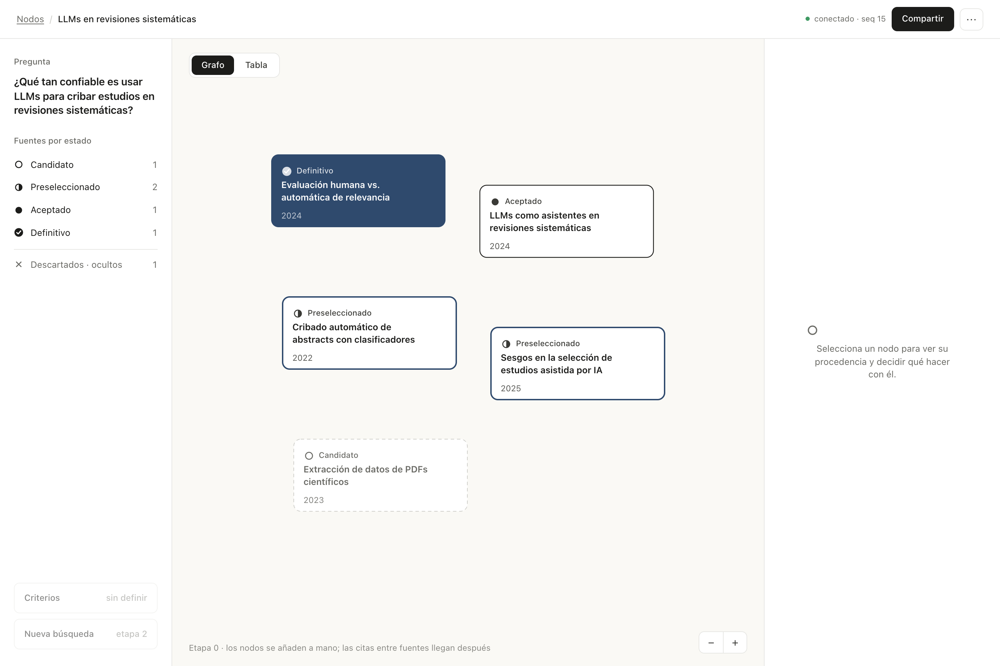

# Criba

Tablero colaborativo de investigación donde cada nodo —paper, artículo o página— conserva su
procedencia, y cada decisión de aceptarlo o descartarlo queda registrada con su motivo.

**Principio rector: la IA sugiere, la persona decide.** Ningún agente cambia el estado de un nodo.

## Estado

**Etapa 1 (Esqueleto) completa.** El plan por etapas vive en [`docs/ETAPAS.md`](docs/ETAPAS.md). El circuito funciona de punta a punta: comando por REST →
transacción en PostgreSQL → evento externalizado a Kafka → hecho reenviado por WebSocket → tablero
actualizado en otra pestaña, con la interfaz ya vestida según `docs/DISENO.md`.

**Etapa 2 (Agente buscador) en curso.** El corte 2.1 está completo: `criba-agents` consume
`agent.tasks` y deduplica, todavía sin ejecutar ninguna tarea.



## Estructura

```
apps/
  api/          Spring Boot 4.1 — monolito modular (Spring Modulith 2.1)
  agents/       Worker Spring Boot 4.1: consumidor de agent.tasks
  web/          SPA TanStack Router + Query
compose.yaml    PostgreSQL 18 + Kafka 4.3 (KRaft, un nodo)
docs/
  Arquitectura — App de research transparente con IA (Java + Kafka).md   el qué y el por qué
  PROPUESTA-ARQUITECTURA.md                                              el cómo y el estado
  ETAPAS.md                                                              el plan por etapas y qué está hecho
  DISENO.md                                                              tokens y estructura de la interfaz
  diseno/                                                                pantallas de referencia
  capturas/                                                              cómo se ve la etapa 0
```

## Requisitos

- Docker con Compose
- JDK 25 (`/usr/libexec/java_home -v 25`); Maven lo trae el wrapper
- Node 24+ y pnpm (`npm i -g pnpm`); npm también sirve

## Arranque

```bash
docker compose up -d                     # PostgreSQL en 5433, Kafka en 9092
cd apps/api  && ./mvnw spring-boot:run   # API en 8081
cd apps/web  && pnpm install && pnpm dev # interfaz en http://localhost:5173
cd apps/agents && ./mvnw spring-boot:run # worker, sin puerto HTTP
```

Los puertos no son los de fábrica a propósito: **5433** porque el 5432 suele estar ocupado por otro
proyecto, y **8081** por la misma razón con el 8080.

## Comprobar que el circuito está cerrado

```bash
# 1. Crear un tablero y un nodo
curl -s -X POST localhost:8081/api/boards -H 'Content-Type: application/json' \
  -d '{"title":"Prueba","researchQuestion":"¿Pregunta?"}'

# 2. Ver el evento en Kafka (sin kcat: el consumidor del propio contenedor)
docker exec criba-kafka /opt/kafka/bin/kafka-console-consumer.sh \
  --bootstrap-server localhost:9092 --topic board.events --from-beginning \
  --timeout-ms 5000 \
  --value-deserializer org.apache.kafka.common.serialization.StringDeserializer
```

La clave del mensaje es el `boardId` y el valor es el sobre completo: `eventId`, `seq`,
`schemaVersion`, `type`, `actor`, `correlationId` y `payload`.

```bash
# 3. Comprobar el canal de hechos sin abrir el navegador
cd apps/web && node scripts/check-realtime.mjs <boardId>
# en otra terminal, cambia el estado de un nodo y verás el evento llegar
```

En el navegador: abre `http://localhost:5173/boards/<boardId>` en dos pestañas y crea o mueve un
nodo en una; la otra se actualiza en menos de un segundo.

## Comprobar el consumidor

Arranca `apps/agents` en dos terminales: cada instancia se queda con tres de las seis particiones, y
al matar una con `kill -9` la otra asume las seis (tarda lo que el `session.timeout` del grupo).

```bash
# Publica la misma tarea dos veces: una línea «Tarea nueva» y otra «Duplicado ignorado» en el log.
TAREA='b1|{"eventId":"11111111-1111-1111-1111-111111111111","boardId":"22222222-2222-2222-2222-222222222222","type":"Prueba"}'
printf '%s\n%s\n' "$TAREA" "$TAREA" | docker exec -i criba-kafka \
  /opt/kafka/bin/kafka-console-producer.sh --bootstrap-server localhost:9092 --topic agent.tasks \
  --reader-property parse.key=true --reader-property 'key.separator=|'

# Particiones, offsets confirmados y lag del grupo.
docker exec criba-kafka /opt/kafka/bin/kafka-consumer-groups.sh \
  --bootstrap-server localhost:9092 --describe --group agents
```

## Pruebas

```bash
cd apps/api && ./mvnw verify     # máquina de estados, claves naturales, modularidad y el módulo board
                                 # con PostgreSQL y Kafka reales (Testcontainers), más cobertura
cd apps/agents && ./mvnw verify  # deduplicación, offsets y fallos, con PostgreSQL y Kafka reales
cd apps/web && pnpm typecheck && pnpm test && pnpm build
```

## Reglas del repositorio

1. **La API es la única escritora de las tablas de auditoría.** Los agentes proponen con eventos;
   la API valida y persiste.
2. **Ningún módulo consume un tópico que su propio deployable produce.** Kafka es integración, no
   un bus interno: los eventos de dominio viajan en proceso.
3. **Toda llamada que gasta la key del usuario reserva su peor caso antes de hacerse**, contra el
   presupuesto de la operación y el diario de la key (ver §4 de la propuesta).
4. Commits en imperativo y con alcance: `feat(board): registra decisiones con motivo obligatorio`.
5. **Todo cambio entra a `main` por pull request y con las pruebas en verde**, desarrollado con TDD
   (ver [`CONTRIBUTING.md`](CONTRIBUTING.md)).

## Notas técnicas que cuestan una tarde si se descubren tarde

- **Jackson 3.** Spring Boot 4 serializa con `tools.jackson` (Jackson 3), pero `spring-kafka` sigue
  ofreciendo el `JsonSerializer` de Jackson 2. Con él, la construcción del productor falla con
  `NoClassDefFoundError: com/fasterxml/jackson/core/type/TypeReference`.
- **El serializer del productor es `ByteArraySerializer`.** Modulith entrega el evento ya
  serializado a JSON; si se configura un serializador JSON, el mensaje sale envuelto en base64.
- **El discriminador `kind` ocupa el nombre.** Por eso el tipo de nodo viaja como `nodeKind` en
  `NodeCreated`: `kind` es del `@JsonTypeInfo` y no se puede reutilizar en el payload.
- **`@ApplicationModuleTest` arranca el módulo solo.** Para incluir sus dependencias hace falta
  `mode = BootstrapMode.DIRECT_DEPENDENCIES`; si no, faltan beans como `CurrentActor`.
- **El registro de publicaciones de Modulith no es la transacción.** La fila de `event_publication`
  sí entra en la transacción de negocio, pero el envío a Kafka ocurre después del commit: la entrega
  es at-least-once y el consumidor tendrá que deduplicar por `eventId`.

## Licencia

[MIT](LICENSE).

## Documentación

- `docs/ETAPAS.md` — qué se construye en cada etapa y en qué orden; única fuente de verdad.
- `docs/Arquitectura …md` — propuesta de valor, conceptos de dominio, ADR 1–12.
- `docs/PROPUESTA-ARQUITECTURA.md` — arquitectura de arranque: tres planos, entrega at-least-once,
  control del gasto, etapas y ADR 13–23.
